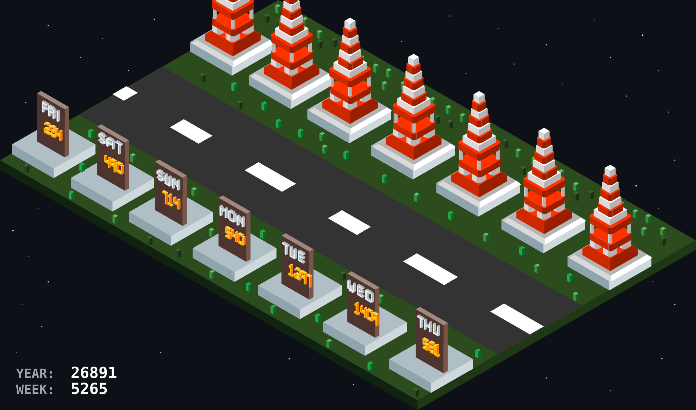

# GitHub Contribution City



[English](README.md) | [한국어](docs/README.ko.md)

---

## Overview

This project generates an isometric 3D city based on your GitHub commits from the last 7 days. Each building represents a day's commits — the more commits, the bigger the building!

The city above is generated daily for [@Mustaqeem66](https://github.com/Mustaqeem66) by the workflow in this repository.

<br>

## Building Types

| Commits | Building | Preview |
|---------|----------|---------|
| 0 | No building | - |
| 1-3 | Lantern (Xsmall.svg) |  |
| 4-6 | Blue House (Small.svg) |  |
| 7-9 | Mansion (Middle.svg) |  |
| 10+ | Red Tower (Big.svg) |  |

<br>

## Setup

### Step 1. Create Repository

- Create a repository from this one under your own account.

### Step 2. Enable the workflow

No personal access token is required. The workflow uses the built-in `GITHUB_TOKEN` with `permissions: contents: write`, which is enough to read the public contribution calendar and commit the generated SVG back to this repository.

### Step 3. Run Workflow

1. Actions → Generate Contribution City → Run workflow
2. The workflow re-runs every day at 18:00 UTC.
3. After completion, add this to your profile README:

```md

```

> Replace `{{USERNAME}}` and `{{REPO_NAME}}` with your GitHub username and repository name.

## Project Structure

```
your-repo/
├── .github/
│   └── workflows/
│       └── contribution-city.yml
├── assets/
│   ├── font/
│   │   └── Galmuri11.ttf   # subset to the glyphs used by the city
│   ├── Base.svg
│   ├── Xsmall.svg, Small.svg, Middle.svg, Big.svg
│   ├── MON.svg ~ SUN.svg
│   └── 0.svg ~ 9.svg
├── generate-city.js
├── contribution-city.svg
└── README.md
```

## Environment Variables

| Variable | Required | Description |
|----------|----------|-------------|
| `GITHUB_TOKEN` | Yes | Token with access to the contribution calendar (the workflow's built-in token works) |
| `GITHUB_USERNAME` | Yes | Target GitHub username |

## Notes

- The bundled Galmuri11 font is subset to the characters rendered in the city (`0-9`, `YEAR:`, `WEEK:`), which keeps the output around 200 KB instead of several megabytes.

## Acknowledgements

This project was heavily inspired by [github-profile-3d-contrib](https://github.com/yoshi389111/github-profile-3d-contrib) by yoshi389111.

## License

MIT License

## Font

- [Galmuri11](https://github.com/quiple/galmuri) by quiple
