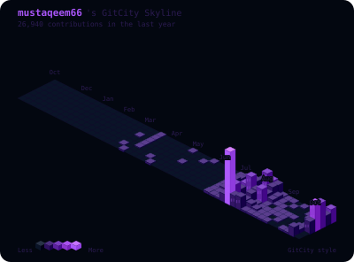

# GitHub Contribution City

An isometric contribution graph generator with two outputs:

| Output | Range | Style |
|--------|-------|-------|
| `gitcity.svg` | **entire year** | Full-year isometric skyline (53 weeks × 7 days) |
| `contribution-city.svg` | **last 7 days** | Pixel-art city, one building per day |

Both files are regenerated every night by the workflow in this repository.

## Full-year skyline



Rendered in the [GitCity](https://github.com/rishabhbhartiya/GitCity) style: every day of the year is a tower, height scales with the day's contribution count, and months are labelled along the edge.

## This week's city


[English](README.md) | [한국어](docs/README.ko.md)

---

## Building Types (weekly city)

| Commits | Building | Preview |
|---------|----------|---------|
| 0 | No building | - |
| 1-3 | Lantern (Xsmall.svg) |  |
| 4-6 | Blue House (Small.svg) |  |
| 7-9 | Mansion (Middle.svg) |  |
| 10+ | Red Tower (Big.svg) |  |

<br>

## Setup

### Step 1. Create Repository

- Create a repository from this one under your own account.

### Step 2. Enable the workflow

No personal access token is required. The workflow uses the built-in `GITHUB_TOKEN` with `permissions: contents: write`, which is enough to read the public contribution calendar and commit the generated SVGs back to this repository.

### Step 3. Run Workflow

1. Actions → Generate Contribution City → Run workflow
2. The workflow re-runs every day at 18:00 UTC.
3. After completion, add this to your profile README:

```md


```

> Replace `{{USERNAME}}` and `{{REPO_NAME}}` with your GitHub username and repository name.

## Project Structure

```
your-repo/
├── .github/
│   └── workflows/
│       └── contribution-city.yml
├── assets/
│   ├── font/
│   │   └── Galmuri11.ttf   # subset to the glyphs used by the city
│   ├── Base.svg
│   ├── Xsmall.svg, Small.svg, Middle.svg, Big.svg
│   ├── MON.svg ~ SUN.svg
│   └── 0.svg ~ 9.svg
├── generate-city.js        # weekly city
├── gitcity.js              # full-year skyline
├── contribution-city.svg
├── gitcity.svg
└── README.md
```

## Environment Variables

| Variable | Required | Description |
|----------|----------|-------------|
| `GITHUB_TOKEN` | Yes | Token with access to the contribution calendar (the workflow's built-in token works) |
| `GITHUB_USERNAME` | Yes | Target GitHub username |
| `THEME` | No | Skyline theme: `aurora` (default), `matrix`, `noir`, `ocean`, `gold`, `ice` |

## Notes

- The full-year skyline uses the GitHub contribution calendar, so private contributions are included in the counts.
- The bundled Galmuri11 font is subset to the characters rendered in the weekly city (`0-9`, `YEAR:`, `WEEK:`), which keeps its output around 200 KB instead of several megabytes.
- The skyline renderer is adapted from GitCity and keeps Apache-2.0 attribution; see `THIRD_PARTY_NOTICES.md`.

## Acknowledgements

- [GitCity](https://github.com/rishabhbhartiya/GitCity) by Rishabh Bhartiya — full-year isometric renderer
- [github-profile-3d-contrib](https://github.com/yoshi389111/github-profile-3d-contrib) by yoshi389111 — weekly city inspiration
- [Galmuri11](https://github.com/quiple/galmuri) by quiple — pixel font

## License

The original generator is MIT licensed. Adapted code retains its upstream license:

- `gitcity.js` — Apache License 2.0 (`LICENSES/Apache-2.0.txt`)
- `assets/font/Galmuri11.ttf` — SIL Open Font License 1.1
